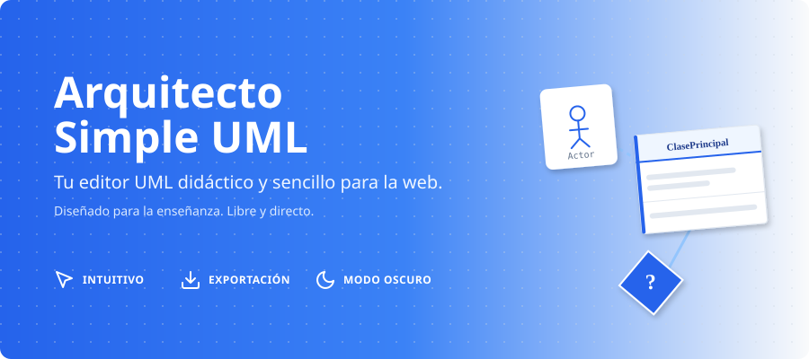
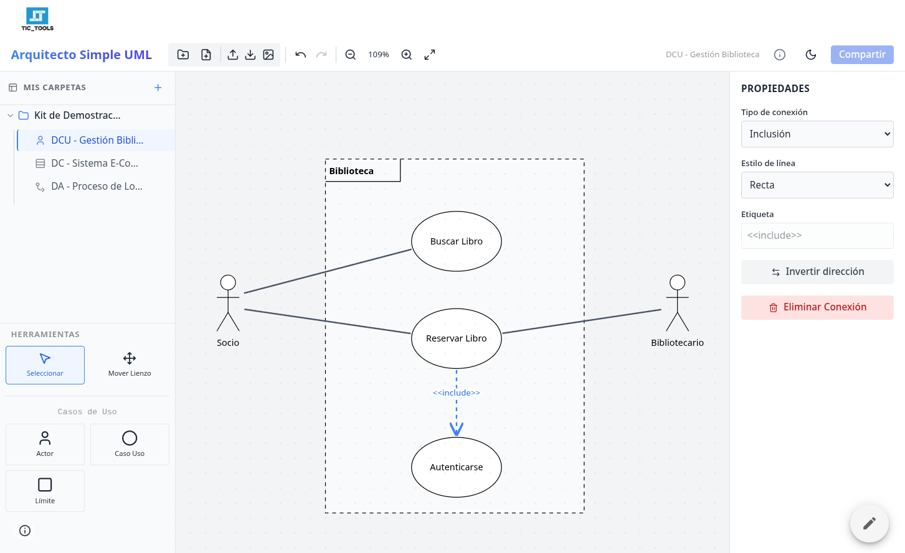
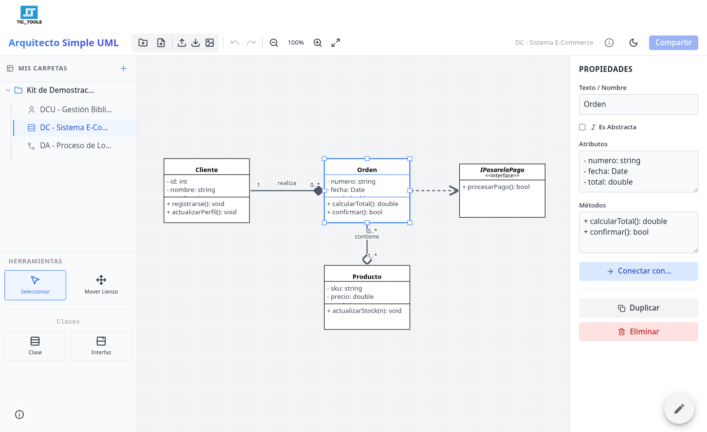
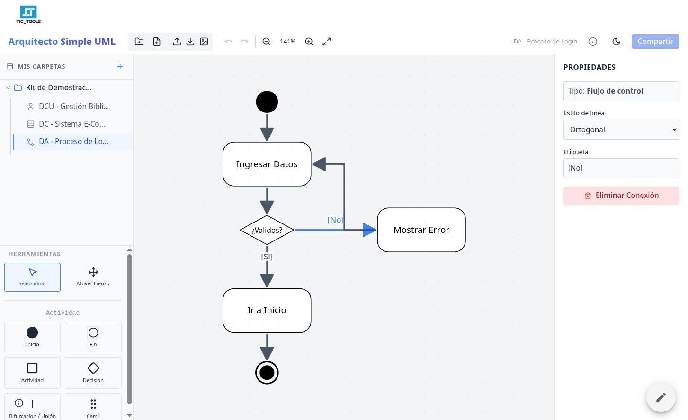

# Arquitecto Simple UML

**Arquitecto Simple UML (AS-UML)** es un editor de UML ligero, experimental y diseñado con fines didácticos para crear diagramas de manera sencilla. Es una Single Page Application (SPA) contenida en un único archivo HTML, lo que facilita su distribución y uso sin instalaciones complejas.

## Demo en línea

Puedes utilizar el editor sin limitaciones y directamente en tu navegador accediendo a:

👉 **[https://umlsimple.pablofelip.online](https://umlsimple.pablofelip.online)** (versión oficial, en Google Sites)

👉 **[https://pfelipm.github.io/arquitecto-uml](https://pfelipm.github.io/arquitecto-uml/)** (GitHub Pages): aquí **el navegador conserva los diagramas** aunque recargues la página o vuelvas otro día, y los enlaces compartidos se abren con un clic.

## Vídeo de novedades

Un recorrido de poco más de un minuto por las novedades de las versiones 8.0 «Revisión» y 9.1 «Notación»: revisar diagrama, mensajes que explican, redimensionado, notación UML 2, puntos de paso, alinear y repartir, compartir por enlace, exportar a SVG y atajos de teclado.

  <video src="https://github.com/user-attachments/assets/b28f7fe7-9919-4d00-bc0c-60751a181c74" controls width="640"></video>

La locución es sintética (texto a voz de Google Chrome). También puedes [descargar el vídeo](https://github.com/pfelipm/arquitecto-uml/releases/download/v9.1/arquitecto-uml-9.1-novedades.mp4) desde la [versión 9.1](https://github.com/pfelipm/arquitecto-uml/releases/tag/v9.1).

## Características principales

*   **Tipos de diagramas:**
    *   **DCU:** Diagramas de casos de uso (actores, casos de uso, límites del sistema). Las relaciones `<<extend>>` pueden indicar su condición, que se muestra entre llaves junto a la flecha o, con la notación oficial de UML, en una nota (`Condition: {…}` y, opcionalmente, `extension point: …`).
        
        
    *   **DC:** Diagramas de clases (clases, interfaces, relaciones). Las asociaciones admiten multiplicidades y **nombres de rol** en cada extremo. Admite varias asociaciones entre las mismas clases (por ejemplo, *origen* y *destino*), que se dibujan separadas. Los miembros que empiezan por `static` se muestran subrayados y los que empiezan por `abstract`, en cursiva, siguiendo la notación UML (por ejemplo, `+ static total: int`).
        
        
    *   **DA:** Diagramas de actividad (inicio, fin, actividades, decisión / fusión, bifurcación / unión, carriles). Los carriles se encajan uno al lado del otro para formar la tabla de responsables (actores, departamentos u objetos, con el nombre subrayado) y, al moverlos, arrastran las acciones que contienen; lo mismo ocurre con el límite del sistema en los DCU. Las barras de bifurcación y unión se crean horizontales, se giran con un botón del panel de propiedades y los flujos llegan a ellas en perpendicular, cada uno en su posición.
        
        
*   **Revisar diagrama:** El botón **Revisar** (o **F7**) abre un panel que analiza el diagrama abierto y señala errores UML habituales, con fines didácticos: casos de uso sin actor o fuera del límite del sistema, herencias circulares, clases con métodos abstractos que no están marcadas como abstractas, interfaces sin implementar, diagramas de actividad sin nodo inicial, decisiones sin guardas, nodos inalcanzables, etc. Los problemas se clasifican en errores, avisos y sugerencias de estilo (que se pueden ocultar); al pulsar uno, se seleccionan en el lienzo los elementos afectados. La revisión se actualiza mientras editas y nunca modifica el diagrama.
*   **Notas UML:** en los tres tipos de diagrama, la herramienta **Nota** añade un comentario (rectángulo con la esquina doblada, con texto de varias líneas) que se une con una línea discontinua al elemento que explica. Útil para enunciados y correcciones; la revisión del diagrama no las tiene en cuenta.
*   **Trazado de las relaciones:** las relaciones pueden ser rectas u ortogonales (en codo). Para evitar cruces, se les pueden añadir **puntos de paso** con doble clic (o doble toque) sobre la relación seleccionada y arrastrarlos; doble clic sobre un punto lo quita, y el botón **Enderezar** del panel de propiedades los quita todos. En los diagramas de actividad, los **flujos de vuelta** (los que suben a un elemento anterior, como un bucle de reintento) rodean automáticamente los elementos intermedios.
*   **Alinear y repartir:** con varios elementos seleccionados, el panel de propiedades permite alinearlos, repartirlos con la misma separación e igualar su ancho o su alto.
*   **Gestión de proyectos:** Organización en carpetas con varios diagramas, que se pueden duplicar (por ejemplo, para guardar versiones o repartir un diagrama de partida).
*   **Persistencia local:** Guardado automático en el navegador (`localStorage`); al volver, se reabre el último diagrama abierto. En la versión insertada en Google Sites el navegador no conserva los datos entre visitas, así que la aplicación lo avisa y recuerda exportar una copia JSON antes de salir; en la versión de GitHub Pages sí se conservan.
*   **Compartir por enlace:** El botón **Compartir** genera un enlace que contiene el diagrama abierto (comprimido y sin pasar por ningún servidor). Quien lo recibe lo pega en **Abrir diagrama compartido** y obtiene una copia en la carpeta «Diagramas compartidos», sin que se modifiquen sus otros diagramas. Los enlaces generados desde GitHub Pages (o cualquier copia abierta directamente, no insertada en Google Sites) abren el diagrama con un clic.
*   **Importar y exportar:** Copias de seguridad completas en formato JSON (incluye un [kit de demostración](readme-archivos/kit-demo.json) para pruebas). Al importar una copia, puedes **añadir** sus carpetas a las tuyas o **reemplazar** todo tu contenido. También permite exportar diagramas como imagen PNG en alta resolución o como imagen vectorial SVG, nítida a cualquier tamaño en documentos, presentaciones y LaTeX.
*   **Interfaz moderna:** Diseño limpio con soporte para **modo oscuro**, zoom hacia el cursor, guías de alineación inteligentes y atajos de teclado y ratón (consulta la tabla siguiente o pulsa **?** en la aplicación).

## Atajos de teclado y ratón

En macOS, usa ⌘ en lugar de Ctrl.

| Atajo | Acción |
|---|---|
| **Ctrl+Z** | Deshacer |
| **Ctrl+Mayús+Z** · **Ctrl+Y** | Rehacer |
| **Ctrl+C** · **Ctrl+X** · **Ctrl+V** | Copiar, cortar y pegar elementos (también entre diagramas del mismo tipo) |
| **Ctrl+D** | Duplicar la selección |
| **Supr** · **Retroceso** | Eliminar la selección |
| **Ctrl+A** | Seleccionar todos los elementos |
| **Esc** | Cancelar la conexión o la herramienta activa; si no hay ninguna, deseleccionar |
| **Flechas** / **Mayús+flechas** | Mover la selección 1 px / 10 px |
| **Ctrl+arrastrar un tirador** | Redimensionar de forma simétrica, sin mover el centro (laterales: ancho; superior e inferior: alto; esquinas: ambos) |
| **Mayús+arrastrar una esquina** | Redimensionar manteniendo la proporción (con Ctrl, también desde el centro) |
| **Mayús+clic** | Añadir o quitar un elemento de la selección |
| **Arrastrar en el fondo** | Seleccionar con un recuadro (con **Mayús**, añadir a la selección) |
| **Doble clic** | Editar el texto de un elemento |
| **Doble clic en una relación seleccionada** | Añadir un punto de paso (después, arrástralo); doble clic sobre un punto lo quita |
| **Rueda** / **Mayús+rueda** | Desplazar el lienzo (en vertical / en horizontal) |
| **Ctrl+rueda** | Zoom hacia el cursor |
| **Ctrl+0** | Zoom al 100 % |
| **F7** | Mostrar u ocultar el panel de revisión del diagrama |
| **Botón central** · **Alt+arrastrar** | Mover el lienzo (en algunos escritorios Linux, Alt+arrastrar mueve la ventana) |
| **?** | Mostrar u ocultar la ayuda de atajos |

En tabletas y pantallas táctiles: **toca** para seleccionar, haz **doble toque** para editar el texto, **arrastra con un dedo** para mover elementos (o, sobre el fondo, seleccionar con un recuadro), **pellizca** para el zoom y **arrastra con dos dedos** para desplazar el lienzo. Las acciones que en el ordenador se hacen con el teclado (eliminar, duplicar, conectar) tienen su botón en el panel de propiedades.

## Tecnologías utilizadas

Esta herramienta funciona directamente en el navegador sin backend ("serverless") gracias a:
*   **React 18:** Cargado vía CDN.
*   **Tailwind CSS:** Para el estilizado de la interfaz.
*   **Babel Standalone:** Transpilación de JSX/TypeScript en tiempo de ejecución.
*   **Lucide React:** Iconografía moderna.

## Uso

Simplemente abre el archivo `index.html` en cualquier navegador web moderno. Aunque no se requiere instalar dependencias locales (Node.js, npm, etc.), **se necesita conexión a Internet** para descargar las bibliotecas y estilos a través de CDN. Una [prueba automática](.github/workflows/prueba-carga.yml) comprueba cada día que la aplicación sigue arrancando con las versiones que sirven los CDN.

## Autor

Desarrollado por [Pablo Felip Monferrer](https://www.linkedin.com/in/pfelipm) como herramienta de apoyo para la asignatura de Ingeniería del Software en el grado de Diseño y Desarrollo de Videojuegos de la Universitat Jaume I (UJI).

## Licencia

Este proyecto se distribuye bajo los términos del archivo [LICENSE](LICENSE).
