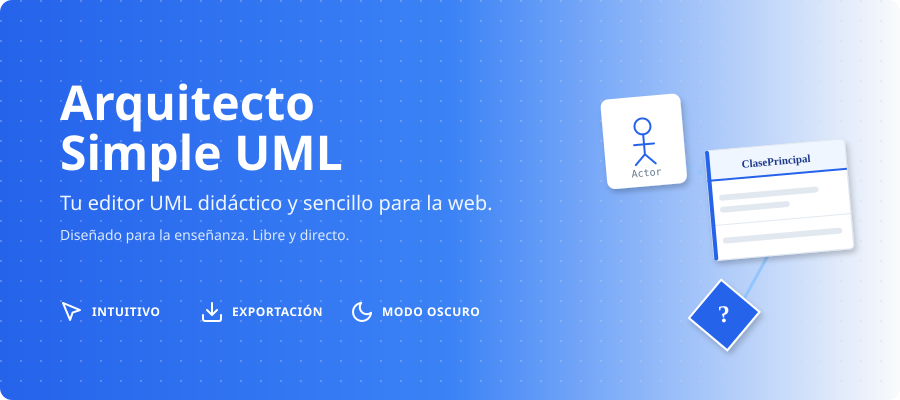
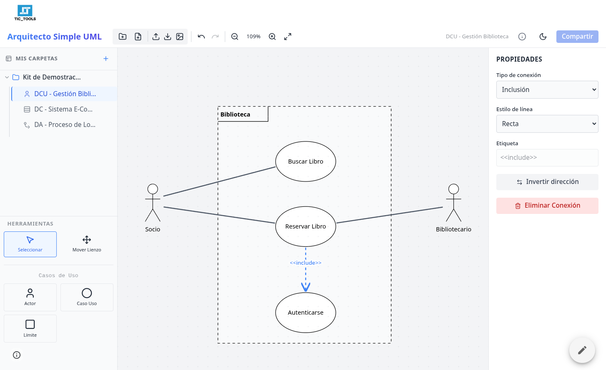
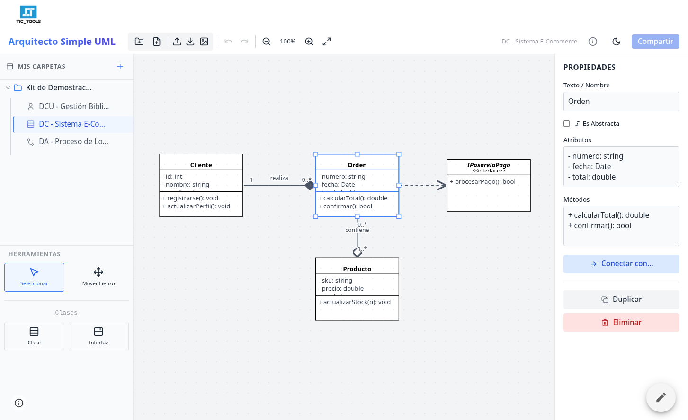
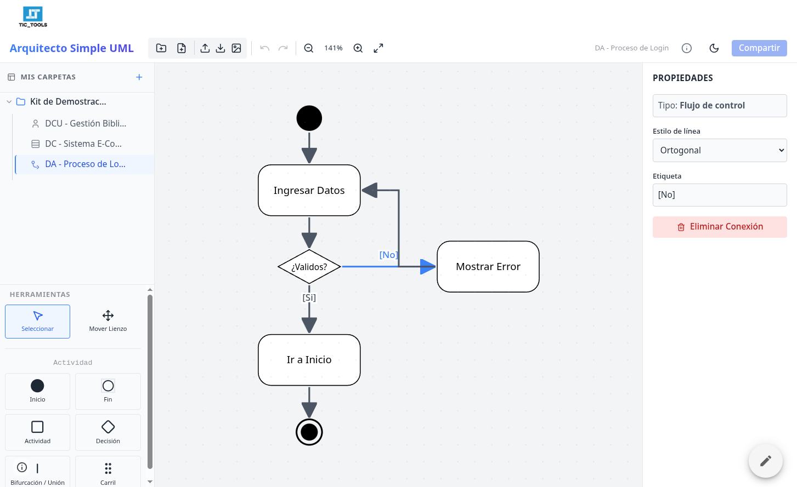

# Arquitecto Simple UML

**Arquitecto Simple UML (AS-UML)** es un editor de UML ligero, experimental y diseñado con fines didácticos para crear diagramas de manera sencilla. Es una Single Page Application (SPA) contenida en un único archivo HTML, lo que facilita su distribución y uso sin instalaciones complejas.

## Demo Online

Puedes utilizar el editor sin limitaciones y directamente en tu navegador accediendo a:

👉 **[https://umlsimple.pablofelip.online](https://umlsimple.pablofelip.online)**

## Características Principales

*   **Tipos de Diagramas Soportados:**
    *   **DCU:** Diagramas de Casos de Uso (Actores, Casos de uso, Límites).
        
        
    *   **DC:** Diagramas de Clases (Clases, Interfaces, Relaciones). Admite varias asociaciones entre las mismas clases (por ejemplo, *origen* y *destino*), que se dibujan separadas.
        
        
    *   **DA:** Diagramas de Actividad (Inicio, Fin, Actividades, Decisiones, Carriles).
        
        
*   **Gestión de Proyectos:** Organización mediante carpetas y múltiples diagramas.
*   **Persistencia Local:** Guardado automático en el navegador (`localStorage`); al volver, se reabre el último diagrama abierto.
*   **Compartir por enlace:** El botón **Compartir** genera un enlace que contiene el diagrama abierto (comprimido y sin pasar por ningún servidor). Quien lo recibe lo pega en **Abrir diagrama compartido** y obtiene una copia en la carpeta «Diagramas compartidos», sin que se modifiquen sus otros diagramas. Si la aplicación se abre directamente (no insertada en Google Sites), basta con abrir el enlace.
*   **Importar/Exportar:** Copias de seguridad completas en formato JSON (incluye un [kit de demostración](readme-archivos/kit-demo.json) para pruebas). Al importar una copia, puedes **añadir** sus carpetas a las tuyas o **reemplazar** todo tu contenido. También permite exportar diagramas a imágenes PNG en alta resolución.
*   **Interfaz Moderna:** Diseño limpio con soporte para **modo oscuro**, zoom hacia el cursor, guías de alineación inteligentes y atajos de teclado (deshacer/rehacer con Ctrl+Z, Ctrl+Mayús+Z o Ctrl+Y; duplicar con Ctrl+D).

## Tecnologías Utilizadas

Esta herramienta funciona directamente en el navegador sin backend ("serverless") gracias a:
*   **React 18:** Cargado vía CDN.
*   **Tailwind CSS:** Para el estilizado de la interfaz.
*   **Babel Standalone:** Transpilación de JSX/TypeScript en tiempo de ejecución.
*   **Lucide React:** Iconografía moderna.

## Uso

Simplemente abre el archivo `index.html` en cualquier navegador web moderno. Aunque no se requiere instalar dependencias locales (Node.js, npm, etc.), **se necesita conexión a Internet** para descargar las bibliotecas y estilos a través de CDN.

## Autor

Desarrollado por [Pablo Felip Monferrer](https://www.linkedin.com/in/pfelipm) como herramienta de apoyo para la asignatura de Ingeniería del Software en el grado de Diseño y Desarrollo de Videojuegos de la Universitat Jaume I (UJI).

## Licencia

Este proyecto se distribuye bajo los términos del archivo [LICENSE](LICENSE).
